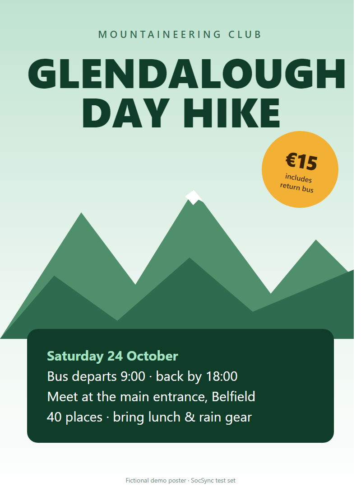
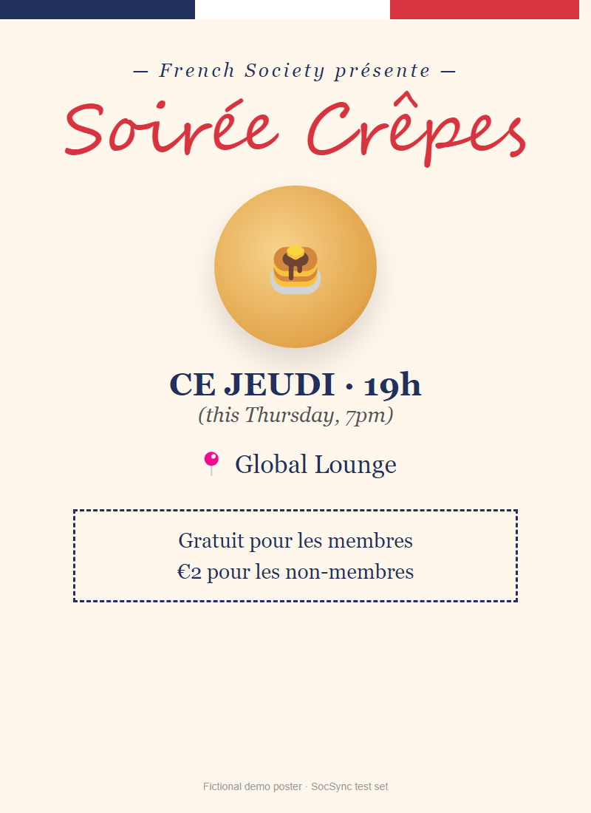
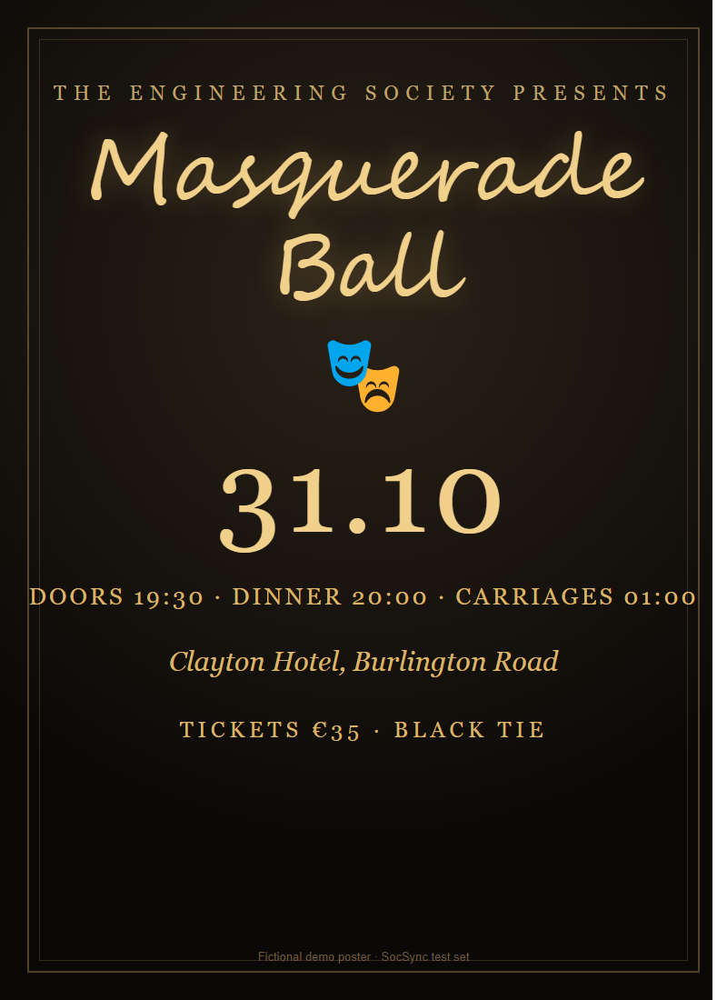
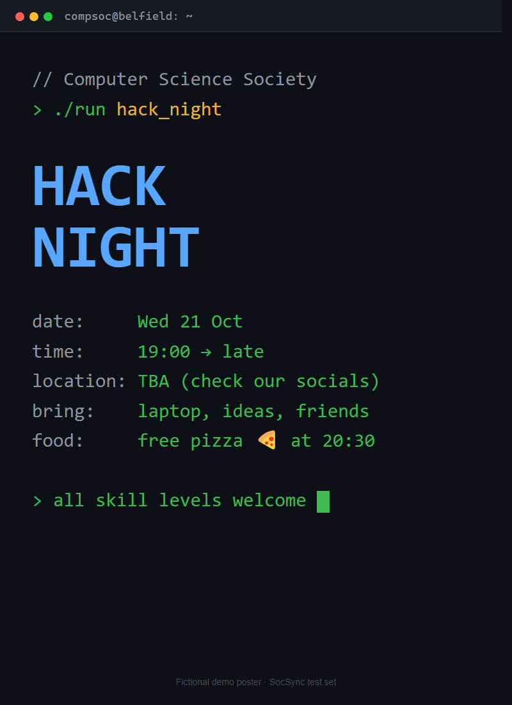
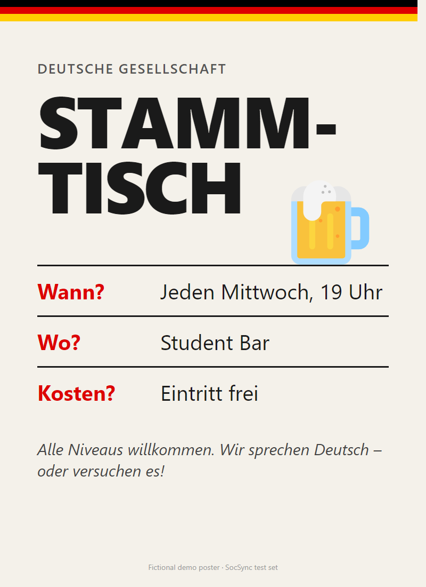
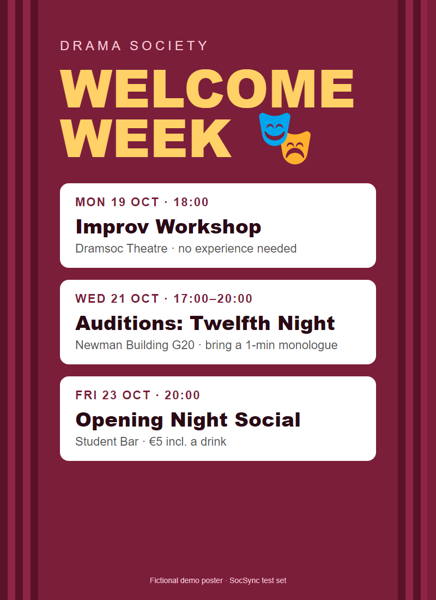
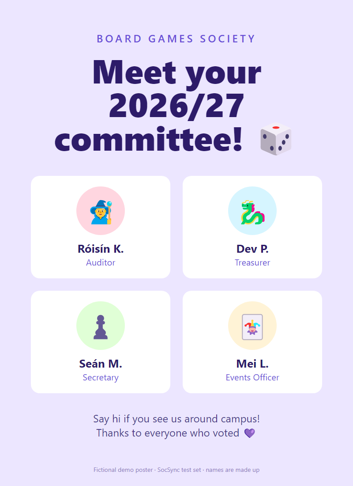
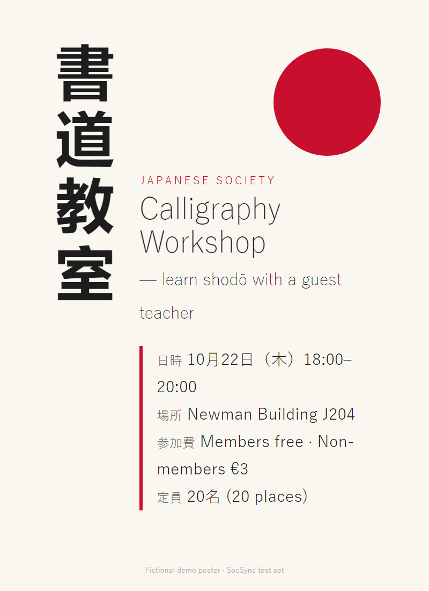

# AI poster import: evaluation results

Run 10/10/2026, 13:45:51 · model `google/gemini-2.5-flash` via OpenRouter · 8 fictional posters · **35/35 fields correct (100%)**

Regenerate with `npm run eval:posters`. Expected dates are computed relative to the run date.

## 1-mountaineering-hike.png
_Tests: Easy: everything clearly stated_ · 3239 ms

| Field | Result | AI output |
|---|---|---|
| title | ✅ | Glendalough Day Hike |
| start | ✅ | 2026-10-24T09:00 |
| end | ✅ | 2026-10-24T18:00 |
| venue | ✅ | Main entrance, Belfield |
| price_eur | ✅ | 15 |
| capacity | ✅ | 40 |

**Description:** The Mountaineering Club is organising a day hike to Glendalough. The bus departs at 9:00 and returns by 18:00. Participants should bring lunch and rain gear.

## 2-french-crepes.png
_Tests: Relative date ('ce jeudi'), French, members-free / €2 non-members_ · 2061 ms

| Field | Result | AI output |
|---|---|---|
| title | ✅ | Soirée Crêpes |
| start | ✅ | 2026-10-15T19:00 |
| venue | ✅ | Global Lounge |
| price_eur | ✅ | 2 |

**Description:** The French Society is hosting a crêpes night. It is free for members and €2 for non-members.

## 3-engineering-ball.png
_Tests: Script font, '31.10' date format, ends after midnight_ · 2229 ms

| Field | Result | AI output |
|---|---|---|
| title | ✅ | Masquerade Ball |
| start | ✅ | 2026-10-31T19:30 |
| end | ✅ | 2026-11-01T01:00 |
| venue | ✅ | Clayton Hotel, Burlington Road |
| price_eur | ✅ | 35 |

**Description:** The Engineering Society presents a Masquerade Ball. Dinner is at 20:00 and carriages are at 01:00. The dress code is black tie.

## 4-compsoc-hacknight.png
_Tests: Venue 'TBA', end time 'late', terminal styling_ · 1905 ms

| Field | Result | AI output |
|---|---|---|
| title | ✅ | Hack Night |
| start | ✅ | 2026-10-21T19:00 |
| end | ✅ | (empty) |
| venue | ✅ | (empty) |
| price_eur | ✅ | 0 |

**Description:** This hack night is for all skill levels. Bring your laptop, ideas, and friends. Free pizza will be provided at 20:30.

**Warnings shown to admin:** No venue found. · AI was unsure about: venue

## 5-german-stammtisch.png
_Tests: All in German, weekly recurring ('jeden Mittwoch')_ · 2229 ms

| Field | Result | AI output |
|---|---|---|
| title | ✅ | Stammtisch |
| start | ✅ | 2026-10-14T19:00 |
| venue | ✅ | Student Bar |
| price_eur | ✅ | 0 |
| description | ✅ | This is a German conversation event for all levels. Attendees will speak German or try to. |
| warning: says it repeats | ✅ | This event repeats (every Wednesday). Only the next date was filled in; add the rest as separate events. |

**Description:** This is a German conversation event for all levels. Attendees will speak German or try to.

**Warnings shown to admin:** This event repeats (every Wednesday). Only the next date was filled in; add the rest as separate events.

## 6-drama-welcome-week.png
_Tests: THREE events on one poster (app imports one at a time)_ · 2032 ms

| Field | Result | AI output |
|---|---|---|
| title | ✅ | Improv Workshop |
| warning: lists the 2 other events | ✅ | This poster lists 3 events. Imported the first one; import the others separately: Auditions: Twelfth Night (WED 21 OCT 17:00-20:00), Opening Night Social (FRI 23 OCT 20:00). |

**Description:** This improv workshop is for anyone interested, no experience needed.

**Warnings shown to admin:** This poster lists 3 events. Imported the first one; import the others separately: Auditions: Twelfth Night (WED 21 OCT 17:00-20:00), Opening Night Social (FRI 23 OCT 20:00). · AI was unsure about: end · AI was unsure about: price_eur · AI was unsure about: capacity

_Limitation test: which event does it pick, and does it warn about the others?_

## 7-boardgames-committee.png
_Tests: NOT an event (committee announcement)_ · 1598 ms

| Field | Result | AI output |
|---|---|---|
| rejected as not-an-event | ✅ | rejected |

## 8-japanese-calligraphy.png
_Tests: Japanese date format 10月22日（木）, mixed languages, capacity 定員20名_ · 1857 ms

| Field | Result | AI output |
|---|---|---|
| title | ✅ | Calligraphy Workshop |
| start | ✅ | 2026-10-22T18:00 |
| end | ✅ | 2026-10-22T20:00 |
| venue | ✅ | Newman Building J204 |
| price_eur | ✅ | 3 |
| capacity | ✅ | 20 |

**Description:** Learn shodō with a guest teacher. This workshop is for members and non-members.

